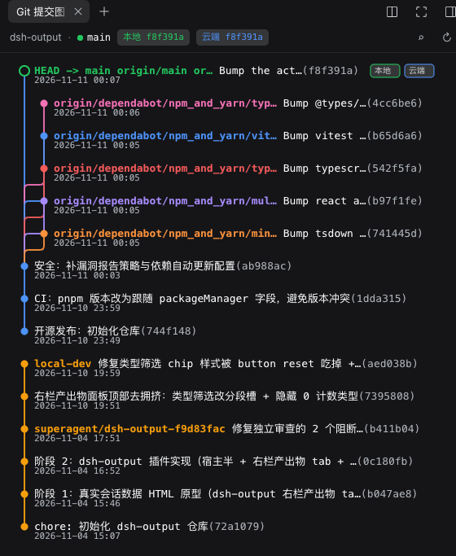

# @kulebbb/dsh-git-tree

[中文](README.md) · English

A right-sidebar plugin for the DSH desktop app (DeepSeek Harness.app): it draws the git commit/branch DAG of **the project that belongs to the current session** in a right-sidebar tab. It uses the same tab mechanism as Files, Browser, and Terminal — expand the right sidebar → click "+" to open the start page → click the "Git commit graph" card, or press `⌘⇧G` (`Ctrl+Shift+G` on Windows / Linux).

You do not need to pick a project: the panel follows the session's working directory, and switching sessions switches projects. Each session's right-sidebar layout is independent (if you opened it in a session, it appears in that session).

> **Platform support**: from **v0.7.0** onward this plugin supports the **DSH desktop app** only, and no longer supports `dsh web`. You need a DSH version that has the right sidebar (0.2.x).
>
> This plugin is community-maintained and is not an official DeepSeek component.

Repository: <https://github.com/kulebbb/dsh-git-tree> · npm: <https://www.npmjs.com/package/@kulebbb/dsh-git-tree>

This package is a **bundle**: `dsh.bundle.patch` points at the shipped `cordis.patch.yml`, so the DSH desktop "Plugins" page can install, enable, and uninstall it directly — you do not need to hand-edit the profile's `cordis.patch.yml`.

Version history: v0.5.0 switched to bundle distribution; v0.6.0 moved the entry point from a "left-sidebar button + fullscreen overlay" to a **right-sidebar tab type** and removed the workspace picker; v0.7.0 kept the desktop app only and removed one-click update inside the panel plus `POST /git-tree/update`; v0.7.1 updated the copyright holder and listing metadata, with no change to runtime behavior; v0.7.2 requires `ctx.connection.admit()` before `GET /git-tree/graph` and `GET /git-tree/update/status`, and limits graph `cwd` to the current session's workspace. Trade-offs and impact are documented in `docs/decisions/2026-10-29-desktop-only.md`.

## Screenshot



## Structure

| File | Role |
|---|---|
| `lib/index.js` | Node half: registers `GET /git-tree/graph?session=&cwd=&n=` and `GET /git-tree/update/status` on the webserver. Both routes call `ctx.connection.admit()` first; graph `cwd` stays inside the current session workspace. Read-only, does not write the profile |
| `lib/client.js` | Browser half: registers the right-sidebar tab type (`git-tree`) + start-page card + SVG commit graph (`__ModuleLoader__` bundle) |
| `lib/git.js` / `lib/parse.js` | Process invocation and a pure parser |
| `lib/update.js` | Version comparison and npm registry latest-version lookup |
| `cordis.patch.yml` | Bundle patch: inserts this package as the `git-tree` loader |
| `locale/*.json` / `icon.svg` | Title, description, and icon shown on the Plugins page |
| `docs/decisions/` | Architecture decision records (including the "desktop only" decision) |
| `test/` | `node --test` unit tests + fixture-repo scripts (repo only; not published with the npm package) |

## Install (desktop)

The Git install address is `github:kulebbb/dsh-git-tree`. To pin a commit, write `github:kulebbb/dsh-git-tree#<40-char-commit>`. The `lib/` directory in the repo is the runtime entry (committed JavaScript, not TypeScript awaiting compilation); there is no `build` / `prepare`. Installing from Git does not compile, and you do not need to enable `allowBuilds` for this package in the profile's `pnpm-workspace.yaml`.

The public npm package name is `@kulebbb/dsh-git-tree` (maintained by this repository; **from 0.7.0** it is the desktop-only version; 0.4.0 and earlier are rejected by the Plugins page as "not a bundle"). The unscoped `dsh-git-tree` is a package by a different author — do not install that one.

The desktop app exclusively owns the profile named `desktop`. A standalone `dsh` CLI (verified against `@deepseek-ai/dsh@0.2.2-rc.1`) will refuse that name outright: `profile "desktop" is managed exclusively by the Electron application`. Do not `pnpm add` into `~/.dsh/profiles/desktop`, and do not start or stop the app with the CLI. Install, update, and uninstall from the "Plugins" page:

1. Open the "Plugins" page in the sidebar → Install, and enter either of the following:
   - Git: `github:kulebbb/dsh-git-tree` (you can also paste `https://github.com/kulebbb/dsh-git-tree`; use this when changes have not been published yet)
   - npm: `@kulebbb/dsh-git-tree`
2. After installation, **restart DeepSeek Harness** as prompted (the desktop app has no HMR; the new plugin takes effect after a restart).
3. After restart, expand the right sidebar → click "+" to open the start page → click the "Git commit graph" card.

For your own profiles whose name is not `desktop`, you can install into the bundle layer with the official CLI (the UI still only appears in the desktop right sidebar; `dsh web` does not support this plugin):

```sh
dsh plugin --profile <profile> add github:kulebbb/dsh-git-tree
```

You can also install it with the agent's `plugin_manager` tool: `action: install_bundle`, with `target` set to `github:kulebbb/dsh-git-tree` or `@kulebbb/dsh-git-tree`.

**Update and uninstall**: the desktop app has no "Update" button. Updating means reinstalling the new version on the "Plugins" page (the plugin manager overwrites the install and prompts for a restart). Uninstall is also on the "Plugins" page; if it says you need to stop DSH first, quit the app as prompted and then continue.

## Upgrading from older versions

- **v0.4.0 (the hand-edited patch install)**: delete the old `insert` row first, then install 0.7.2 from the "Plugins" page. Otherwise the same id will have two sources (one from the profile patch and one from the bundle): startup will not fail, but enable/disable on the Plugins page will be attributed to the wrong layer, and uninstall may report that "the bundle is in use".

  ```yaml
  # ~/.dsh/profiles/desktop/cordis.patch.yml — delete this block
  - insert:
      - id: git-tree
        name: '@kulebbb/dsh-git-tree'
  ```

  After installing, confirm there is only one Git tree entry in the plugin list on the "Plugins" page (the desktop profile cannot run `--dump-config` against the CLI).

- **v0.5.0 / 0.6.0**: a normal reinstall from the "Plugins" page is enough; no extra manual steps.
- **Previously installed in a `dsh web` profile**: Web is no longer supported from 0.7.0. Remove this plugin from that profile with `pnpm remove @kulebbb/dsh-git-tree`; if it was originally installed the v0.4.0 way, also delete the `insert git-tree` block in that profile's `cordis.patch.yml`; if it was installed as a v0.5.0+ bundle, remove the package name from the `dsh.profile.bundles` list.
- The "Update" button that shipped with v0.4.0 only installs the new version as a regular dependency and does not write `dsh.profile.bundles` — follow this section to upgrade, and do not click the old Update button.

## 🤖 One-shot install for agents

Copy **either** of the prompts below (Chinese or English) to your AI assistant (DeepSeek / Claude / Cursor, etc.), and it will complete the install. To also install [dsh-vision](https://github.com/kulebbb/dsh-vision), send both plugins' prompts together and the assistant will do them in sequence.

**Chinese**

```text
你是一个安装助手。请帮我把 DSH（DeepSeek Harness）桌面端插件 @kulebbb/dsh-git-tree 安装到桌面端 profile（desktop）。

【背景】
@kulebbb/dsh-git-tree 是一个 bundle：自带 cordis.patch.yml，会在 DSH 右侧栏注册一个「Git 提交图」标签页（与文件、浏览器、终端同级），打开后展示当前会话所属项目的 git 提交/分支图。无第三方运行时依赖，仅支持 DSH 桌面端（不支持 dsh web）。

【安装步骤】
1. 先检查桌面端 profile 的 cordis.patch.yml：如果里面已有 id 为 git-tree 的插入行（v0.4.0 的老装法），先删掉那段再继续，否则同一 id 会有两条来源。
2. 优先使用 plugin_manager 工具的 install_bundle，target 填 github:kulebbb/dsh-git-tree 或 @kulebbb/dsh-git-tree（未发版时用 Git 地址）。
3. 如果没有 plugin_manager 工具或调用被拒绝，告诉我用侧边栏「插件」页安装，并说明步骤。
4. 不要手工编辑桌面端 profile 的 package.json 或 cordis.patch.yml，也不要在 profile 目录里跑 pnpm——桌面端的 profile 由 App 独占管理。

【验证】
- 安装结果里 application 为 applied 或 restart-required；restart-required 时需要重启 DeepSeek Harness。
- 重启后：展开右侧栏 → 点「＋」→ 点「Git 提交图」卡片，面板展示当前会话项目的提交/分支图。

【异常处理】
- 任何错误把完整信息原样转达给我，不要自行改配置或换方案。
- 需要我确认的信息先问我，再继续。
```

**English**

```text
You are an installation assistant. Install the DSH (DeepSeek Harness) desktop plugin @kulebbb/dsh-git-tree into the desktop profile.

[Context]
@kulebbb/dsh-git-tree is a bundle: it ships its own cordis.patch.yml and registers a "Git commit graph" tab in the DSH right sidebar (alongside Files, Browser and Terminal) that renders the commit/branch graph of the current session's project. No third-party runtime dependencies. Desktop app only — `dsh web` is not supported.

[Install]
1. First check the desktop profile's cordis.patch.yml: if it already has an insert row with id git-tree (the v0.4.0 setup), delete that block first — otherwise the same id comes from two layers.
2. Prefer the plugin_manager tool with action install_bundle and target github:kulebbb/dsh-git-tree or @kulebbb/dsh-git-tree (use the Git target for unreleased changes).
3. If plugin_manager is unavailable or refused, tell me to install it from the sidebar Plugins page and give the steps.
4. Do not hand-edit the desktop profile's package.json or cordis.patch.yml, and do not run pnpm in the profile directory — the desktop app owns its profile.

[Verify]
- The install result reports application applied or restart-required; when it is restart-required, restart DeepSeek Harness.
- After restart: expand the right sidebar, click "+", and choose the "Git commit graph" card; the panel shows the current session project's commit/branch graph.

[On errors]
- Relay the full error verbatim; do not improvise config changes or fall back to other approaches.
- Ask me before continuing whenever you need information I have not provided.
```

## New-version notice

On startup the plugin **silently** checks whether the npm registry has a newer version (it does not block startup, degrades automatically when offline, and does not produce log noise):

- After the Git panel is opened, a thin banner appears below the status row: "New version {latest} (current {current}). Reinstall it from the DSH sidebar Plugins page to update."
- The desktop app does not provide an "Update" button: the desktop profile is owned exclusively by the app, and install/update are both done on the "Plugins" page (for unofficial plugins, that means "reinstall the new version").
- The banner can be dismissed with ✕; the dismissed state is kept only in the current panel instance, and the check runs again when the panel is remounted.

## API

`GET /git-tree/graph?session=<session id>&cwd=<directory inside the workspace>&n=<1..2000>` → `{ok, repo, commits, refs}`. Error payload `{ok:false, error:{code, message}}`, with code ∈ `invalid-cwd | not-a-git-repo | git-unavailable | git-timeout | git-error | internal`. `not-a-git-repo` returns `200` + `ok:false` (a soft error the UI uses to show a hint); `invalid-cwd` returns `400`; other errors return `500`. `session` selects the session whose workspace the host owns. Omitting `cwd` uses that workspace root. A provided `cwd` may be absolute or relative to the root, and after `realpath` it must stay inside the workspace.

`commits[].date` is the author time (ISO 8601, `%aI`). The frontend shows it on a second line under each commit subject, formatted as YYYY-MM-DD HH:mm in the browser's local time zone. `commits[].shortHash` is a 7-character short hash; it is shown at the end of each subject line in a muted GitHub-style color (e.g. `feat: xxx (9259220)`). Clicking the row still copies the full hash.

### Long text and horizontal scrolling

Commit-row text is measured in pixel width before rendering. **Overlong subjects are automatically truncated with "…"**. SVG width is capped at the panel's visible content width, and **a horizontal scrollbar never appears** (long text is truncated, never used to widen the view). Hovering any commit row shows a custom tooltip with the **full commit message** (full subject + commit body + hash + author + local time + refs) and **code-change stats** (in the `1 file changed, 24 insertions(+), 16 deletions(-)` style, from `git log --shortstat`; merge commits with no changes omit that line).

### Status bar and local / remote HEAD

A status bar stays at the top of the panel:

- Project name (the directory name of the current session's working directory; hover to see the full path)
- `⑂ <branch-name>`: shows "detached" when HEAD is detached
- `↑n ↓m`: ahead/behind counts (`git rev-list --left-right --count HEAD...<ref>`). The remote side uses the current branch's `@{upstream}`, falling back to `origin/<branch-name>` when that is not configured, and is omitted when both sides are in sync
- Two small chips, "Local <7-char-hash>" and "Remote <7-char-hash>"; when there is no upstream, the remote chip shows "Not pushed"
- Two buttons on the right: search (expands a filter row; Esc collapses it) and refresh

Graph markers stay in sync: the local HEAD commit dot is a **green hollow ring**, and the remote HEAD commit dot is a blue dashed ring. In a wide panel, "Local" and "Remote" badges are appended at the end of the row; they are hidden in a narrow panel (the status bar already shows both hashes).

Payload shape: `commits[].body` (commit body, possibly an empty string), `commits[].stats` (`{files, insertions, deletions}`, or `null` for commits with no changes), `repo.localHead` (`{hash, branch|null}`), `repo.remoteHead` (`{ref, hash, ahead, behind}|null`).

`GET /git-tree/update/status` → `{ok, current, latest, newer, checkError}`. `latest` is `null` when the check failed or the client is offline (the UI degrades silently); `newer` means the registry version is actually higher than the current version. Non-GET methods return `405` with `error.code = method-not-allowed`. The plugin does not provide any install/update write API.

Both routes call `ctx.connection.admit(req)` before doing any work. A failed admission uses the status from the host: `401` with body `unauthorized`, or `403` with body `forbidden`. Git does not run, and the update payload is not returned.

## Security

Graph runs git only inside the workspace the host records for the current session. The root is the `path` of the `ctx.workspaceRegistry.list()` record whose `sessionIds` include that session. When the registry has no such membership, the fallback is `ctx.sessions.get(sessionId).header.cwd`. Both `cwd` and the root are passed through `realpath`. The result must equal the root or sit under it, using a path-boundary check so `/a/b` does not admit `/a/bc`. A path that is outside, missing, or that escapes through `..` or a symlink returns `400` + `invalid-cwd`. Keep the web server bound to the loopback address (default `127.0.0.1`); do not expose it to the network with `--host 0.0.0.0`.

## Tests

```sh
node --test          # from the repository root; zero dependencies, runs with system node
```

## License

[MIT](LICENSE)
