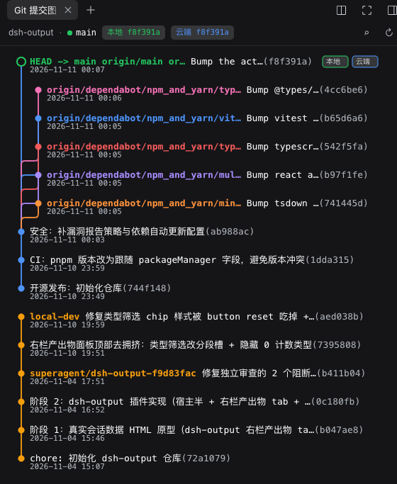

# @kulebbb/dsh-git-tree

中文 · [English](README.en.md)

DSH 桌面端（DeepSeek Harness.app）右侧栏插件：在右侧栏的标签页里用图形展示**当前会话所属项目**的 git 提交/分支 DAG。它和文件、浏览器、终端是同一套 tab 机制——展开右侧栏 → 点「＋」打开开始页 → 点「Git 提交图」卡片，或按 `⌘⇧G`（Windows / Linux 为 `Ctrl+Shift+G`）。

项目不需要选择：面板直接跟随会话的工作目录，切换会话即切换项目；每个会话的右侧栏布局相互独立（在哪个会话打开过，就在哪个会话里出现）。

> **平台支持**：自 **v0.7.0** 起只支持 **DSH 桌面端**，不再支持 `dsh web`。需要带右侧栏的 DSH 版本（0.2.x）。
>
> 本插件由社区维护，不是 DeepSeek 官方组件。

仓库：<https://github.com/kulebbb/dsh-git-tree> · npm：<https://www.npmjs.com/package/@kulebbb/dsh-git-tree>

本包是一个 **bundle（组合包）**：`dsh.bundle.patch` 指向自带的 `cordis.patch.yml`，因此可以被 DSH 桌面端的「插件」页直接安装、启用和卸载，不需要手工编辑 profile 的 `cordis.patch.yml`。

版本脉络见 [CHANGELOG.md](CHANGELOG.md)。

## 截图



## 安装（桌面端）

从 Git 安装的地址是 `github:kulebbb/dsh-git-tree`。要钉住一次提交，写成 `github:kulebbb/dsh-git-tree#<40位commit>`。仓库里的 `lib/` 就是运行入口（已提交的 JavaScript，不是待编译的 TypeScript），没有 `build` / `prepare`。从 Git 安装不会编译，也不需要在 profile 的 `pnpm-workspace.yaml` 里为本包打开 `allowBuilds`。

npm 上的公开包名是 `@kulebbb/dsh-git-tree`（维护者即本仓库；**0.7.0 起**为桌面端专用版本，0.4.0 及更早会被插件页以「不是组合包」拒绝）。无作用域的 `dsh-git-tree` 是另一个作者的包，不要装那个。

桌面端 App 独占名为 `desktop` 的 profile。独立安装的 `dsh` CLI（已在 `@deepseek-ai/dsh@0.2.2-rc.1` 上核对）遇到这个名字会直接拒绝：`profile "desktop" is managed exclusively by the Electron application`。不要往 `~/.dsh/profiles/desktop` 里 `pnpm add`，也不要用 CLI 启停 App。安装、更新、卸载走「插件」页：

1. 侧边栏打开「插件」页 → 安装，填入下面任一地址：
   - Git：`github:kulebbb/dsh-git-tree`（也可粘贴 `https://github.com/kulebbb/dsh-git-tree`；改动未发版时用这个）
   - npm：`@kulebbb/dsh-git-tree`
2. 安装完成后按提示**重启 DeepSeek Harness**（桌面端没有 HMR，重启后新插件才生效）。
3. 重启后展开右侧栏 → 点「＋」打开开始页 → 点「Git 提交图」卡片。

自己的、名字不是 `desktop` 的 profile，可以用官方 CLI 装进组合层（界面仍然只在桌面端右侧栏出现，`dsh web` 不支持本插件）：

```sh
dsh plugin --profile <profile> add github:kulebbb/dsh-git-tree
```

也可以用 agent 的 `plugin_manager` 工具安装：`action: install_bundle`，`target` 填 `github:kulebbb/dsh-git-tree` 或 `@kulebbb/dsh-git-tree`。

**更新与卸载**：桌面端没有「更新」按钮，更新＝在「插件」页重新安装新版本（插件管理器会覆盖安装并提示重启）；卸载也在「插件」页，若提示需要先停止 DSH，按提示退出 App 后再操作。

## 使用

面板顶部的状态条显示项目名、分支、领先/落后，以及本地与云端 HEAD。悬停提交行会看到完整提交说明和代码变动量；过长的标题会以省略号截断，提交图不会出现横向滚动条。

接口、payload，以及状态条与 tooltip 的实现细节见 [docs/api.md](docs/api.md)。

## 新版本提示

插件启动时**静默**检查 npm registry 是否有新版本（不阻塞启动、离线时自动降级、不产生日志噪音）：

- 打开 Git 面板后，状态行下方显示细横幅：「新版本 {latest}（当前 {current}），请在 DSH 侧边栏「插件」页重装以更新」。
- 桌面端不提供「更新」按钮：桌面 profile 由 App 独占管理，安装/更新都交给「插件」页（对非官方插件是「重装新版本」）。
- 横幅可 ✕ 关闭；关闭状态只保留在当前面板实例内，面板重新挂载时会重新检查。

## 从旧版本升级

从 v0.4.0（手工改过 profile 的 `cordis.patch.yml`）升级时，先删掉旧的 `insert git-tree` 行，再在「插件」页安装 0.7.2，否则同一 id 会有两条来源；v0.5.0 / 0.6.0 直接重装即可。若曾装在 `dsh web` 的 profile 里，0.7.0 起请移除（`pnpm remove`，并按当时的装法清理 patch 或 `dsh.profile.bundles`）。不要点 v0.4.0 自带的「更新」按钮。逐步说明（含要删除的 YAML）见 [docs/upgrade.md](docs/upgrade.md)。

## 🤖 Agent 一键安装

把下面**任一段**提示词（中文或英文）复制发给你的 AI 助手（DeepSeek / Claude / Cursor 等），它会自动完成安装。如需同时安装 [dsh-vision](https://github.com/kulebbb/dsh-vision)，把两个插件的提示词一起发给助手，它会依次完成。

**中文版**

```text
你是一个安装助手。请帮我把 DSH（DeepSeek Harness）桌面端插件 @kulebbb/dsh-git-tree 安装到桌面端 profile（desktop）。

【背景】
@kulebbb/dsh-git-tree 是一个 bundle：自带 cordis.patch.yml，会在 DSH 右侧栏注册一个「Git 提交图」标签页（与文件、浏览器、终端同级），打开后展示当前会话所属项目的 git 提交/分支图。无第三方运行时依赖，仅支持 DSH 桌面端（不支持 dsh web）。

【安装步骤】
1. 先检查桌面端 profile 的 cordis.patch.yml：如果里面已有 id 为 git-tree 的插入行（v0.4.0 的老装法），先删掉那段再继续，否则同一 id 会有两条来源。
2. 优先使用 plugin_manager 工具的 install_bundle，target 填 github:kulebbb/dsh-git-tree 或 @kulebbb/dsh-git-tree（未发版时用 Git 地址）。
3. 如果没有 plugin_manager 工具或调用被拒绝，告诉我用侧边栏「插件」页安装，并说明步骤。
4. 不要手工编辑桌面端 profile 的 package.json 或 cordis.patch.yml，也不要在 profile 目录里跑 pnpm——桌面端的 profile 由 App 独占管理。

【验证】
- 安装结果里 application 为 applied 或 restart-required；restart-required 时需要重启 DeepSeek Harness。
- 重启后：展开右侧栏 → 点「＋」→ 点「Git 提交图」卡片，面板展示当前会话项目的提交/分支图。

【异常处理】
- 任何错误把完整信息原样转达给我，不要自行改配置或换方案。
- 需要我确认的信息先问我，再继续。
```

**English**

```text
You are an installation assistant. Install the DSH (DeepSeek Harness) desktop plugin @kulebbb/dsh-git-tree into the desktop profile.

[Context]
@kulebbb/dsh-git-tree is a bundle: it ships its own cordis.patch.yml and registers a "Git commit graph" tab in the DSH right sidebar (alongside Files, Browser and Terminal) that renders the commit/branch graph of the current session's project. No third-party runtime dependencies. Desktop app only — `dsh web` is not supported.

[Install]
1. First check the desktop profile's cordis.patch.yml: if it already has an insert row with id git-tree (the v0.4.0 setup), delete that block first — otherwise the same id comes from two layers.
2. Prefer the plugin_manager tool with action install_bundle and target github:kulebbb/dsh-git-tree or @kulebbb/dsh-git-tree (use the Git target for unreleased changes).
3. If plugin_manager is unavailable or refused, tell me to install it from the sidebar Plugins page and give the steps.
4. Do not hand-edit the desktop profile's package.json or cordis.patch.yml, and do not run pnpm in the profile directory — the desktop app owns its profile.

[Verify]
- The install result reports application applied or restart-required; when it is restart-required, restart DeepSeek Harness.
- After restart: expand the right sidebar, click "+", and choose the "Git commit graph" card; the panel shows the current session project's commit/branch graph.

[On errors]
- Relay the full error verbatim; do not improvise config changes or fall back to other approaches.
- Ask me before continuing whenever you need information I have not provided.
```

## 安全说明

graph 只在宿主记录的当前会话工作区内执行 git：工作区根来自 `ctx.workspaceRegistry.list()` 中包含该会话的记录的 `path`；注册表没有这条会话时，回退到 `ctx.sessions.get(sessionId).header.cwd`。`cwd` 与工作区根都会做 `realpath`，结果必须等于根或位于其下（按路径边界判断，`/a/b` 不会误放行 `/a/bc`）。越界、目录不存在，或经 `..` / 符号链接逃出工作区，返回 `400` + `invalid-cwd`。请保持 web server 绑定在回环地址（默认 `127.0.0.1`）；不要用 `--host 0.0.0.0` 暴露到网络。

## 结构

| 文件 | 职责 |
|---|---|
| `lib/index.js` | Node half：在 webserver 注册 `GET /git-tree/graph?session=&cwd=&n=` 与 `GET /git-tree/update/status`。两条路由先经 `ctx.connection.admit()`；graph 的 cwd 限制在当前会话工作区内。只读，不写 profile |
| `lib/client.js` | Browser half：注册右侧栏 tab 类型（`git-tree`）+ 开始页卡片 + SVG 提交图（`__ModuleLoader__` bundle） |
| `lib/git.js` / `lib/parse.js` | 进程调用与纯解析器 |
| `lib/update.js` | 版本比较与 npm registry 最新版本查询 |
| `cordis.patch.yml` | bundle patch：把本包插入为 `git-tree` 加载项 |
| `locale/*.json` / `icon.svg` | 插件页展示用的标题、描述与图标 |
| `docs/decisions/` | 架构决策记录（含「只支持桌面端」的决定） |
| `test/` | node --test 单测 + 夹具仓库脚本（仅仓库，不随 npm 包发布） |

## 测试

```sh
node --test          # 在仓库根目录；零依赖，用系统 node 运行即可
```

## License

[MIT](LICENSE)
